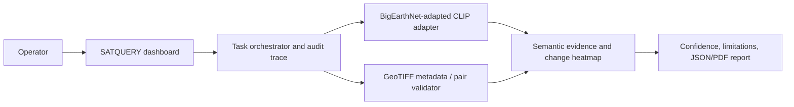

# SATQUERY AI — SIH26167 Submission Evidence

## Architecture



## Demonstration sequence

1. Upload an optical image, ask a natural-language question, and show the evidence regions.
2. Ask to highlight a water body to demonstrate text-guided grounding.
3. Upload two co-registered dates, describe a change, and show the execution trace and semantic heatmap limitation.
4. Upload matched optical and SAR imagery, explain the complementary evidence and sensor limitations.
5. Download the JSON/PDF audit report.
6. Open adapter `/health`; show `ready: true`, checkpoint name, hardware, and training provenance.

## Model-training evidence

| Evidence | Required artifact | Status |
| --- | --- | --- |
| Adapted checkpoint | `models/bigearthnet-clip-adapter.pt` | Pending GPU run |
| Reproducibility metadata | `bigearthnet-clip-adapter.pt.metadata.json` | Generated by `train.py` |
| Held-out retrieval | `runs/adapter-evaluation.json` | Generated by `evaluate.py` |
| Evidence verification | `runs/sih-evidence-readiness.json` | Generated by `verify_sih_evidence.py` |

Training metadata must state the BigEarthNet release/licence, exact train split,
manifest SHA-256, random seed, GPU, epochs, batch size, learning rate, UTC
training time, loss history, and checkpoint SHA-256.

## Metrics table — fill only from held-out reports

| Dataset | Task | Split | Metric | Score | Artifact |
| --- | --- | --- | --- | --- | --- |
| BigEarthNet | image-text retrieval | test | Recall@1 / Recall@5 | Pending | `adapter-evaluation.json` |
| VRSBench | VQA | official held-out | official evaluator metric | Pending | VQA report |
| VRSBench | captioning | official held-out | official evaluator metric | Pending | caption report |
| VRSBench | grounding | official held-out | mIoU / threshold accuracy | Pending | grounding report |
| RSVQA | VQA | official held-out | accuracy | Pending | RSVQA report |
| CDVQA | change VQA | official held-out | accuracy | Pending | CDVQA report |

## Integrity, safety, and licence note

- BigEarthNet source data must be used under its applicable terms. Keep data and checkpoints outside source control.
- VRSBench, RSVQA, CDVQA, and ISRO/SAC held-out data must not be used for model training unless their rules explicitly permit it.
- VRSBench local caption metrics are smoke tests only; retain results from its official evaluator for final reporting.
- The bi-temporal heatmap is semantic decision support, not a pixel-accurate segmentation mask or a basis for changed-area measurement.
- Never claim the adapted model is active unless `/health` returns `ready: true` with the deployed trained checkpoint.

## Local software QA

| Check | Result | Evidence |
| --- | --- | --- |
| Production web build | Passed | `npm run build` completed with Next.js production compilation and TypeScript checks. |
| Automated web tests | Passed | `npm test`: 537 passed; 13 intentionally skipped. |
| ML script syntax | Passed | `train.py`, `evaluate.py`, `benchmark_runner.py`, `prepare_bigearthnet14k.py`, and `verify_sih_evidence.py` compile successfully. |
| Container deployment | Pending environment | Docker is required on the deployment host to start and query the adapter service. |

The remaining evidence must be generated from real datasets and a trained
checkpoint: it must not be substituted with synthetic metrics or placeholder
health responses.

## Final artifact command

```bash
python ml/remote_sensing_adapter/verify_sih_evidence.py \
  --checkpoint models/bigearthnet-clip-adapter.pt \
  --adapter-evaluation runs/adapter-evaluation.json \
  --benchmark-report runs/vrsbench-vqa-report.json \
  --benchmark-report runs/vrsbench-caption-report.json \
  --benchmark-report runs/vrsbench-grounding-report.json \
  --benchmark-report runs/rsvqa-report.json \
  --benchmark-report runs/cdvqa-report.json
```
